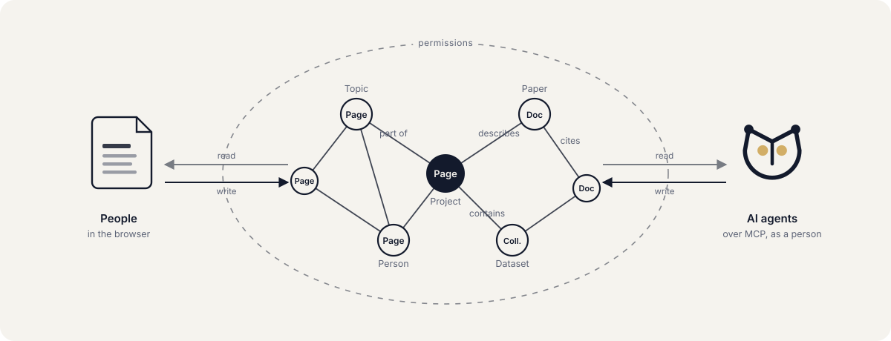

<picture>
  <source media="(prefers-color-scheme: dark)" srcset="src/lib/assets/owlgraph-lockup-light.svg">
  
</picture>

**A semantic knowledge graph to foster collaboration — for people and AI alike.**

owlgraph keeps knowledge as a graph. Every piece of content is a node that
can say what kind of thing it is, what properties it has, and how it relates
to everything else. People and AI agents build that graph together, in the
same structures and under the same rules.

**Status:** early development (0.x). Until a first stable release, the data
model, the APIs and the plugin interface can change.

<picture>
  <source media="(prefers-color-scheme: dark)" srcset="src/lib/assets/concept-dark.svg">
  
</picture>

## Features

**Knowledge is a graph of typed nodes.** Pages are the first kind of node.
Documents and collections are others, and the model is built to take more,
from the core or from plugins. Every node has a class from a hierarchy you
define, properties described by a schema, and typed relationships to other
nodes. The modelling follows the ideas behind RDF and OWL: classes and
subclasses, the properties they inherit, relationships that carry meaning.

**Pages are composed, and can ask the graph.** A page is built from blocks:
text and structure, media, other nodes embedded, and blocks that query the
graph and show what they find. What the editor shows is what the page
publishes.

**People and AI agents collaborate on equal terms.** Agents connect over the
Model Context Protocol and work on the same nodes and blocks as people do in
the browser: they read, search, follow relationships and write. An agent acts
as the person whose token it carries, with exactly that person's permissions.

**One permission model, enforced on the server.** Roles decide what someone
may do; visibility decides what they may see. Visibility is public, internal
or restricted, set per node or inherited from its namespace. The browser, the
API and agents are checked the same way, for the person asking. What someone
may not read never reaches them, and what a page publishes is sanitized.

**Built to be extended.** Plugins add node types, blocks and connections to
other services through a documented interface, and may be licensed as their
authors choose (see [Licence](#licence)). Every block, built in or added, gets
the same handling of layout, spacing, typography and screen sizes.

**Yours to run.** owlgraph is self-hosted: one Postgres database, the app and
an MCP server, as a Docker stack or from source. Your content stays on your
infrastructure, and the code is free software.

## Getting started

With Docker, and nothing else installed:

```bash
git clone https://github.com/owlgraph-dev/owlgraph.git
cd owlgraph
cp .env.example .env    # set POSTGRES_PASSWORD and APP_DB_PASSWORD, 16 characters or more
docker compose up -d --build
docker compose exec app npx tsx --tsconfig tsconfig.tsx.json scripts/create-admin.ts you@example.com "Your Name"
```

Then open <http://localhost:3000> and sign in. There is no sign-up and no
default account: the first admin is the one you create here, and they add
everyone else in the settings. [docs/guides/deployment.md](docs/guides/deployment.md) covers
the stack in detail, including running it in production behind a reverse
proxy, and [docs/guides/backup.md](docs/guides/backup.md) covers backups.

## Connecting an AI agent

The MCP server listens at <http://localhost:3030/mcp> (Streamable HTTP).
Create an API token in the settings and give it to your MCP client as a
bearer token; the agent then works as you, with your permissions. To look
around first, the MCP Inspector works:

```bash
npx @modelcontextprotocol/inspector
```

[docs/architecture/mcp.md](docs/architecture/mcp.md) describes the tools and how an agent writes a page
as blocks.

## Development

To work on owlgraph you need Node.js and a Postgres of your own; the Docker
stack's database is not reachable from the host. The exact prerequisites,
the setup and the gate every change has to pass are in
[CONTRIBUTING.md](CONTRIBUTING.md). Security problems are reported privately,
as [SECURITY.md](SECURITY.md) describes.

## Documentation

[docs/README.md](docs/README.md) is the index of the documentation, grouped by
what you want to do. Good places to start:

- [Architecture](docs/architecture/overview.md) — how the pieces fit together.
- [Semantic layer](docs/architecture/semantic-layer.md) — classes, properties and relationships.
- [Blocks](docs/architecture/blocks/overview.md) — what pages are made of.
- [MCP](docs/architecture/mcp.md) — the agents' server.
- [Writing a plugin](docs/guides/writing-a-plugin.md) — extending owlgraph.
- [Glossary](docs/glossary.md) — the words that mean something particular here.
- [Decision records](docs/adr/) — why owlgraph is the way it is.

## Licence

owlgraph is free software, licensed under the
[GNU Affero General Public License v3.0 only](LICENSE), with an
[additional permission for plugins and clients](PLUGIN-EXCEPTION.md).

In short (the licence texts are what count):

- You may use, run and host owlgraph for any purpose, including commercially.
- If you modify owlgraph and distribute it, or let users interact with it over
  a network, you must publish your changes under the AGPL.
- Plugins built on the documented
  [plugin interface](docs/architecture/plugins.md#the-plugin-interface), and separate
  applications that only use the public API, may be licensed however you like,
  including proprietary.

Every source file carries a short licence header. Files that cannot carry one
(data, images such as the logo and icons) are under the same licence. Work by
others that is part of owlgraph is credited in
[THIRD-PARTY-NOTICES.md](THIRD-PARTY-NOTICES.md);
the licences of the packages it is built with are in
[static/licenses.txt](static/licenses.txt), which a running instance serves at
`/licenses.txt`.
