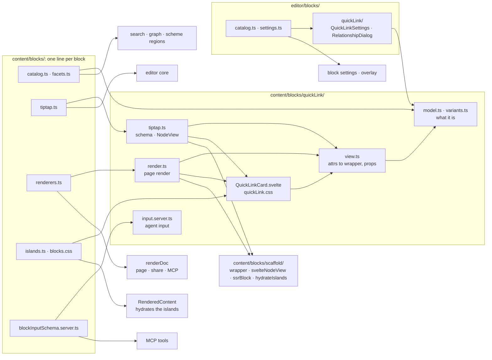

# Block anatomy

What a block kind is made of: one file contract for every kind, the lists that
register it, how one Svelte component draws a block in the editor and on the
page, the steps to add a kind, the names that never change once stored, and
what becomes of a block the running code does not know. The overview and the
name map are in [Blocks](overview.md).

## The file contract

Each block kind lives in a folder under `src/lib/features/content/blocks/<kind>/`,
and a block drawn by a Svelte component follows one file contract: the files
are named by responsibility, the same in every block, and each belongs to one
audience, so the bundle rules ([architecture/overview.md](../overview.md#entry-points-and-boundary-rules))
stay checkable. The quick link (`quickLink/`) is the template for a leaf block, the image (`image/`) for a leaf
with editor chrome, the diagram (`diagram/`) for a leaf with behaviour
of its own in the editor and on the page, the table (`table/`) for a
[container](#svelte-container-blocks), the flex row (`flex/`) for a
[container without chrome](#containers-without-chrome), the grid
(`grid/`) for one with construction handles, the query block (`query/`)
for a container that is its own content element. The text blocks
(paragraph, heading, callout, list, code, quote, rule) and the placeholder
keep the same file names but draw through Tiptap's `renderHTML`: what
ProseMirror owns is their content, and they have neither behaviour nor
chrome a component would carry.

| File | What it holds | Loaded by |
|---|---|---|
| `model.ts` | what the block is: its attrs, a new node, what it points to, its facets | everything — pure, isomorphic |
| `<concern>.ts` | a sub-concern, named for itself: the quick link's `variants.ts`, the table's `tableStyle.ts`, the grid's `gridMath.ts` (its merged-cell geometry); a block's `operations.ts` (its structural edits) is editor-only and reached only through `tiptap.ts` and `content/editor.ts` | what it serves |
| `view.ts` | how the attrs become what is drawn: the [block wrapper](#svelte-leaf-blocks), the override sets, the component's props | the editor and the page |
| `<Kind>.svelte`, `<kind>.css` | the look: one component for the NodeView, the page render and the island; an authored element, never a chrome primitive | the editor, the page, the island |
| `tiptap.ts` | the Tiptap concerns: the node's schema, its clipboard round trip, its NodeView (`svelteNodeView`) | the editor only (`content/editor.ts`) |
| `render.ts` | the page render for `renderDoc` (`ssrBlock` inside the wrapper) | `renderDoc`: the page, the share link, MCP |
| `input.server.ts` | the agent input: the zod shape and the one mapping to a node | the MCP tools, through `blockInputSchema.server.ts` |
| `*.test.ts` | next to what they test | Vitest |

A block is registered by **one line per list** in `blocks/`, each list for
one audience:

- `catalog.ts` — what a block *is*: its group, addressable by `blockId`,
  structural (container chrome rather than content), transient
  (editor-only), spaced, a flow, the family of node it embeds
  ([One family in the editor](node-embeds.md#one-family-in-the-editor)). The editor's live
  id backfill, the server-side backfill and the phone editor's structural
  check all derive their type sets from it.
- `facets.ts` — what other features ask a block: its searchable text, the
  graph edges it declares, the ground it paints for the scheme regions, a
  one-line preview for agents. Search, the graph and the scheme regions call
  `blockText`, `blockEdges` and `blockFacets`; none of them names a block
  type.
- `tiptap.ts` — every block's Tiptap extensions, the list the editor core
  mounts.
- `renderers.ts` — every block's page renderer, keyed by the catalogue's
  names, so the compiler rejects a kind without a public render.
- `islands.ts` — the components the page hydrates.
- `blocks.css` — every block's stylesheet; the editor and the page import
  this one file, so a stylesheet reaches both or neither.
- `blockInputSchema.server.ts` (beside `blocks/`) — the agent-facing
  taxonomy, joining each block's input; the capability shapes an input
  builds on are `capabilities/inputShapes.server.ts`.

`blocks/scaffold/` is what a Svelte block is built with (the wrapper,
`svelteNodeView`, `ssrBlock`, `hydrateIslands`); `blocks/shared/` holds the
editor operations and the global Tiptap extensions every block shares; the
blocks StarterKit provides keep only their render half, each in its own
folder (`quote/`, `rule/`, `code/` — the code block with its attrs). Inline marks and nodes are not
blocks and live in `content/inline/`.

A block's **editing UI** belongs to the editor feature — content never
imports the editor — and mirrors the shape:
`src/lib/features/editor/blocks/<kind>/` holds its settings panel and its
Edit dialog. `editor/blocks/catalog.ts` states what the editor knows per
kind (how Placement places it, which Surface fields its block settings panel offers,
what its Auto rows show, whether the block tools offer Edit), and
`editor/blocks/settings.ts` maps each kind to its settings panel, every panel
taking the same props (`BlockSettingsProps`: the target, the editor, the
actions it may ask for). The block settings panel, its section logic and the
canvas overlay read these instead of checking block types.



How to add a kind is [below](#adding-a-block-kind).

A **plugin's** block kinds join the same lists without touching them: the
catalogue, the facets, the renderers, the islands and the stylesheets read the
plugin registry (`src/lib/plugins/`), and the editor core, the editor's
catalogue, the block settings panel and the Insert menu its editor halves — the block's
files live in its plugin, with the same names ([plugins.md](../plugins.md)).

## Svelte leaf blocks

> Decision: [0011. One Svelte component draws a block everywhere](../../adr/0011-one-svelte-component-draws-a-block-everywhere.md).

A **leaf** block (an atom: no `contentDOM`, ProseMirror owns nothing inside
it) may be drawn by one Svelte component everywhere it appears, instead of
an imperative NodeView and a string renderer that must agree by hand. The
contract is a wrapper description and three small helpers under
`blocks/scaffold/`; the quick-link card (`quickLink/QuickLinkCard.svelte`, all
three variants), the image (`image/PageImage.svelte`), the HTML block
(`html/HtmlBlock.svelte`) and the diagram
(`diagram/Diagram.svelte`) are on it, and the files around them
follow the [block anatomy](#block-anatomy).

- **The block wrapper** (`scaffold/blockWrapper.ts`) is described once —
  `{ classes, blockId, overrides, attrs?, island? }` — and drawn twice:
  `applyWrapper(el, wrapper, styles)` on the editor's NodeView root (class,
  `data-block-id`, `data-b`), `wrapperHtml(wrapper, node, ctx, inner)` as the
  page's element (the same, plus the scheme-region attributes and the
  hydration island's marker). The wrapper's override set — its space above,
  its placement, whatever the block puts on its box — travels as a rule id
  in the editor and on the page; the wrapper never carries a `style` attribute. `attrs`
  are further attributes the block's CSS reads on the block's element — a
  section's `data-width`, the first block's `data-bleed-top` — each a value,
  `''` for a bare attribute or `null` for none; a block names the same keys
  on every update, so a value that goes away removes its attribute.
  ProseMirror's class on a selected node (`ProseMirror-selectednode`) stays
  through `applyWrapper`, so a selected block keeps its selection styles — the
  image's outline — through a block settings edit.
- **`svelteNodeView(Component, { wrapper, props, key, stopEvent })`** is the editor half:
  a NodeView that `mount()`s the component inside the wrapper. `wrapper` and
  `props` are both recomputed on every update — the full prop set each
  time; an attribute change writes the new props into a `$state` object and
  flushes, so the component and the wrapper stay the same elements (the
  selection overlay measures the wrapper; undo coalescing and the
  component's own state survive). `props` receives the editor's **live
  stylesheet** (`capabilities/liveStyles.ts`): `styles.add(set)` is the rule
  id of the component's own element, passed as its `data-b` prop exactly as
  the page passes it, so no component ever takes a `style` prop. `key` names
  a change that needs a fresh view instead. `ignoreMutation` is `true`, as
  for every leaf NodeView, and so is `stopEvent`, with a plain click
  selecting the block — unless the block names the events that are its own
  (`stopEvent`): the image stops only its resize grip's, and leaves its
  click selection and its native drag to ProseMirror, an atom's own
  handling. Editor-only chrome on a leaf — the image's grip
  (`image/ImageResizeHandle.svelte`) — follows the containers' rules
  ([below](#svelte-container-blocks)): a child component rendered only while
  editing, its operations a prop, nothing beside it as text.
- **`ssrBlock(Component, props)`** is the page half: `svelte/server`'s
  `render()`, returned as the string the block's `render.ts` gives the
  walker. The props must be plain JSON — the same object is serialized into
  the wrapper by **`islandMarker(kind, props, esc)`** (`data-island`,
  `data-props`), and the rule id the block's override set got from the
  collector is one of them (`data-b`), so the hydrated tree carries it too.
- **`hydrateIslands(root, registry)`** runs on the page
  (`RenderedContent.svelte`, after the content is in the DOM): every
  `[data-island]` whose kind the registry knows is `hydrate()`d in place
  with its serialized props. Hydration claims the server's elements — the
  markers `render()` leaves must still be there, which is why `renderDoc`'s
  output is never sanitized as a whole — so an attribute the component sets
  only on the client (`data-hydrated`) appears without a mismatch. No
  inline script is involved; the component comes from the app bundle, and
  the registry is a static import so its CSS is in that bundle. The scheme
  regions of `schemeRegions.ts` (`data-scheme`) are a different thing.
- **An island with behaviour of its own** — the diagram, which draws itself
  — keeps it in the component, alike in the editor and on the page. The server renders
  the state the client starts in (the diagram's "Rendering diagram…"), so
  hydration claims an identical tree; what only the browser can make (the
  drawing) arrives afterwards, from an effect; and what the block reacts to
  reaches it as a window event that the editor and the page send
  (`content-scheme-change`: the editor's preview, an adaptive page's
  scheme), never as code in the page's content component. A text the
  component shows is a prop in the interface's language, handed in by
  `tiptap.ts` and `render.ts`, so the component imports no messages and its
  props stay plain JSON; an editor-only text — an empty block's hint — is
  `null` on the page.
- **HTML a component renders** (`{@html}`) is sanitized by whoever hands it
  in, never by the component: the HTML block's NodeView passes the preview
  sanitizer's output (`htmlBlockSanitize.ts`), its renderer
  `sanitizeFragment`'s — after a query template substituted its values.

What stays with the NodeView and the renderer — the wrapper, `data-block-id`,
the capability classes and carriers, the island marker — is what keeps the
capability cascade, the selection overlay and the strict `style-src`
untouched: the component renders *inside* the wrapper and never learns about
capabilities. What the component draws is an **authored element**: a plain
element in the block's classes, styled by the content's layered cascade,
never a chrome primitive — a primitive appears inside a block only as a
control, unchanged. The test when unsure: should an author's Surface,
Typography or Spacing capability be able to change this element? Yes, it is
a surface and block CSS styles it; no, it is a control and the primitive
does ([design-system/tokens.md](../design-system/tokens.md#cascade-layers)).

A control keeps the chrome's look wherever its block stands, scheme regions
included: a region's element declares the whole scheme set, the chrome's
tokens beside the content palette ([theming.md](../theming.md#emission)), so a
control in a dark section is drawn in the dark scheme, as it would be in dark
chrome. A block draws its controls in the same component as its authored elements, in
one branch on its editor or page signal; a control only the editor needs —
an action that changes the graph, a dialog — is handed in with the editor's
side of the block, so the page never loads it.

Every consumer of `renderDoc` loads the component's module — the app under
Vite, and the MCP server, the page-rendering scripts and the e2e harness
through the Node loader hook in `scripts/lib/svelte-hooks.mjs`
([architecture/overview.md](../overview.md#entry-points-and-boundary-rules)), which
compiles a control's rune modules (`*.svelte.js`, `*.svelte.ts`) too; the
unit tests compile it with the Svelte Vite plugin.

A block that lives outside the content feature — a plugin's
([plugins.md](../plugins.md)) — uses the same scaffold through content's entry points:
the render contract, the wrapper and the island marker from its index,
`svelteNodeView` from its editor entry. It renders its component through the
render context (`RenderContext.ssr`, the same `ssrBlock`) rather than importing
content's server half, and what it needs from outside the document arrives as
`RenderContext.blockData`, keyed by its block id and resolved for the viewer
before the render. A plugin block with no behaviour on the page — the
Nextcloud file block, whose links are plain links — is no island: rendered on
the server alone, its component never reaches the page's client bundle, and
what only the editor does (following its document, its repairs) comes in
through its NodeView's props.

## Shared listings

Some content is drawn the same wherever it appears, whoever lists it: a
listing of entries — a folder's files, a collection's members — has one look,
in any block or view that shows one. Such a surface is a component of the
content feature's own entry, `$lib/features/content/listing`, open to the
core and to a plugin alike ([plugins.md](../plugins.md#boundaries)).

`EntryList` is the first. It draws the box, a header, a column header, rows
— a glyph, a name, a chip, a note under the name (an entry's own title where
the listing calls it otherwise), a second line for a phone, a size, a date
or a kind — a
footer, the skeleton while nothing is listed yet, the empty line and the
placeholder shown instead of the rows (a glyph, a title, a body, one action).
It is presentation only. The caller writes the rows from what it read — the
words, the order, and where following a row leads: opening it in place (a
button), an address (a link) or nothing — and hands in what is its own as
snippets: the header's content (where in the listing, its controls) and a
row's trailing slot (its links, an editor's action on it). The header's and
the trailing slot's classes the caller uses (`el-crumb*`, `el-sort-*`,
`el-node`, `el-download`, `el-chevron`, `el-create`) are styled with the
rest.

Its stylesheet, `listing/entryList.css`, is page content in the base layer
like any block's, and the content stylesheet imports it just before the
plugins' sheets (`blocks/blocks.css`), so it reaches the editor and the page
alike; a view off the canvas imports it beside the component. The component
imports no stylesheet itself: the public renderer loads it under the Node
loader, which cannot load one (`check-boundaries` holds it, for the renderers'
closure and the MCP server's).

`DocumentEntry` is the second: one document as a row or a card — its glyph,
or as a card its preview (an image) or its type as a tile, its title, a chip
after it, a details line and where it is, one link to its content, its
download and the way to its node — or a placeholder in its place (a glyph,
a title, the file's name, a body, one action). The caller writes every word
and address from what it read, and hands in what is its own: an editor's
repairs, as a snippet on the placeholder. Its stylesheet,
`listing/documentEntry.css`, sits beside the listing's in the content
stylesheet; its class names are its own (`de-*`, beside the listing's
`el-*`), whichever block draws it. `listing/format.ts` writes what
the editor and the page show of a file — a size, a day, a type, a glyph — the same on
the server and in the browser.

## Svelte container blocks

A **container** block — one whose content ProseMirror owns — is drawn by one
Svelte component the same way; the table is the template
(`table/Table.svelte`). The component draws the chrome around the
content and an **empty content element** for it:

- **In the editor** the NodeView names that element (`svelteNodeView`'s
  `content`, found in the mounted component right away — `bind:this` is an
  effect, too late for ProseMirror, which reads `contentDOM` when the view is
  created). ProseMirror fills it, and no Svelte node may ever end up inside
  it — no `{@html ''}` anchor, no comment, no text — so whatever decides the
  component's mode sits outside the element. Mutations and events inside it
  are ProseMirror's; every mutation outside it is ignored. The container's
  update comes for every change of its content too, so only the props that
  changed reach the component, and a keystroke in a cell re-renders nothing.
- **On the page** the block's `render.ts` renders the children itself
  (`ctx.renderNode`) and hands them to the component, which places them with
  `{@html}` inside the same element. A container without behaviour on the
  page is no island, so its component never reaches the page's client
  bundle.

The nodes inside the content — the table's rows and cells — keep their own
`renderHTML` and renderers: ProseMirror draws them in the editor. A component
per row or cell would mean hundreds of mounts for nothing.

**In-canvas editing chrome** — the table's column and row resize handles,
the grid's column and row dividers and its cell-merge selection, the image's
resize grip — is part of
the NodeView, not the block settings panel, so it lives with the block on the content
side: a child component the block's component renders only while editing
(`table/TableHandles.svelte`, `grid/GridHandles.svelte`), laid
over the content by measurement. Its geometry changes every frame, so it is
carried by `style:` directives on elements the server never renders — the
guardrail's browser-only case ([design-system/overview.md](../design-system/overview.md#guardrails)).
The block's operations reach it as props, bound by `tiptap.ts`: the
component runs wherever the page renders, and that never reaches
ProseMirror. Chrome that brings the editor's own dependencies — the grid's
merge action is the design system's `Button` — is handed in the same way,
as a component with the editor's side of the block (`editing.handles`), so
the page's render, and every consumer of `renderDoc` under Node, never loads
it. The phone editor draws no construction chrome (`interactive: false`,
[editor.md](../editor.md#structural-type-suppression)).

**Nothing beside the content element.** The editor sets `white-space:
pre-wrap`, so a space Svelte keeps between two elements — the content
element and the chrome after it, or two of the chrome's own layers — is
drawn as a line of its own, and the block is taller in the editor than on
the page. Those elements are written back to back; a spec holds each
container's block exactly as tall as what it draws.

## Containers without chrome

A container with no chrome of its own — the flex row
(`flex/FlexRow.svelte`) — still has two jobs, and they go on two
elements, the same in the editor and on the page:

- **The wrapper is the block.** It carries the block id, the scheme-region
  attributes, and what places the block in the flow around it: its space
  above, its placement in the column (`cap-placement` and its values), its
  width (`data-width`) and its bleed (`data-bleed-top`). It also carries
  the block's group class, since the theme's rhythm default for a group keys
  on the block (`.grp-<group>[data-block-id]`,
  [Capability defaults](capabilities.md#capability-defaults)).
- **The component's element is the content element.** The row is the flex
  box and its cells' parent: its arrangement, padding, rhythm, surface and
  height go on it as one rule id, with the tiers it runs as a column or
  scrolls at (`data-column`, `data-scroll`). In the editor it is
  ProseMirror's (`content: (root) => root.firstElementChild`); on the page it
  holds the rendered cells.

The wrapper has no box of its own — no padding, no border, no surface — so its
box is the row's, and the selection ring, measured from the element with the
block id, outlines the row. CSS that reads the block's element names the
wrapper (`.flex-block`, `.grid-block` for the spacing scale); CSS that reads
the element with the padding names the row through it (`.canvas-blocks >
[data-width='full'] > .flex`, `> .grid` for the full band's side inset,
since `--default-pad-x` is registered non-inheriting). Editor and page have the
same markup, so no selector lists two spellings. The component sets the
row's attributes only inside the NodeView's update, while ProseMirror is not
observing the DOM; an attribute it changed at any other time would read to
ProseMirror as an edit of the content element.

The grid (`grid/Grid.svelte`) has the same shape, and so do
the page section and a query block's template, which are the same grid. Its
wrapper (`.grid-block`) carries the block id, the space above, a grid's
placement (a section's place is its span), the width and the bleed; its row
(`.grid`) the tracks and gap — a section's are the page's column template
—, the row floors, padding, rhythm, surface and height, and the tiers its
cells reflow at, or a section's single column. While editing, the
construction handles sit beside the row inside the wrapper, which positions
them over it; on the page a query template is drawn once per result, each a
wrapper and a row.

The query block's result container is the one container whose block
element is its content element: it holds nothing but the template (in the
editor, the one authoring instance) or the stamped results (on the page),
so the wrapper (`blocks/query/view.ts`: the active format's container classes and
override set, the placement, the width, the bleed, the tiers its row
scrolls at) is drawn with no component. In the editor `wrapperNodeView`
(`scaffold/wrapperNodeView.ts`) makes the wrapper element the NodeView's root and its
content element alike, its override set in the live sheet; on the page the
renderer opens the same wrapper around the results. Its clipboard form stays
Tiptap's `renderHTML`, the attributes as data attributes only.

## Adding a block kind

A new kind is a folder of the files in [the contract](#the-file-contract)
and one line in each list that needs it:

1. **Its folder**, `content/blocks/<kind>/`: `model.ts`, `view.ts`, its
   component and stylesheet, `tiptap.ts` and `render.ts`, and
   `input.server.ts` if agents may author it. Its node type is
   [frozen](#frozen-identifiers) from the first page that stores one, so it is
   chosen with care.
2. **Its capabilities**, declared on its Tiptap node. The block settings panel
   and the editor's capability checks read this marker
   (`capabilities/detect.ts`), never whether a value happens to be set:

   ```ts
   addStorage() {
     return { capabilities: ['spacing', 'surface', 'placement'] };
   },
   ```

   The renderers put the matching `cap-*` classes on the block's element and
   merge the capabilities' override sets into its wrapper
   ([Override sets and the carrier](capabilities.md#override-sets-and-the-carrier)).
   The space above a block is not one of them: a kind the catalogue marks
   `spaced` takes it ([Block spacing](capabilities.md#block-spacing)).
3. **The lists**: its row in `catalog.ts` with its group, its extension in
   `tiptap.ts`, its renderer in `renderers.ts` and its stylesheet in
   `blocks.css`; its component in `islands.ts` if the page hydrates it; its
   row in `facets.ts` if it has text, links or a ground of its own; its input
   in `blockInputSchema.server.ts` if agents may author it.
4. **Its editing UI**, if it has any: a folder under `editor/blocks/<kind>/`
   with its settings panel, its rows in `editor/blocks/catalog.ts` and
   `editor/blocks/settings.ts`, its label in
   `editor/blockSettings/blockLabels.ts`, and an insert command in
   `editor/commands/insert.ts` for the Insert menu to offer.

## Frozen identifiers

Some names outlive the code that defines them, because something outside the
code holds them:

- **Node types, their attr names and values, and mark names** are stored, in
  every page's document and every saved version. Renaming one takes a
  migration that rewrites every document and version; a build that meets a
  name it does not know shows the block as [unknown](#unknown-blocks).
- **Agent kinds and their fields** are the MCP tools' schema. An agent's
  instructions and scripts name them, so renaming one breaks every agent that
  writes blocks.
- **The classes and custom properties a block puts on its elements** — the
  wrapper's `.html-block` or `.quick-link-block`, the `--quick-link-*` or
  `--table-*` families — are what authored CSS targets: the site's free CSS,
  its named styles and the markup of HTML blocks
  ([custom-styles.md](../custom-styles.md)). Renaming one takes a migration
  that rewrites that stored CSS and HTML as well.

A plugin's kinds are frozen the same way. When a plugin leaves, its kinds stay
listed in `RETIRED_BLOCK_KINDS`, so its blocks still say whose they were
([Removing a plugin](../../guides/writing-a-plugin.md#removing-a-plugin)).

## Unknown blocks

A stored page can hold what the running code cannot draw: a node of a type no
block kind defines — a removed plugin's block, a newer build's, a kind
retired from the core — or text under a mark no extension defines.
ProseMirror refuses a whole document over a single one, which would open the
page empty and let the next save replace it. Nothing of a page is lost to
one (`content/doc/unknownBlocks.ts`):

- **What is kept** is a node or a mark of a type this build does not know.
  What a newer build added to a kind this build knows — an attr of its own,
  a setting of the page — is not: this build's schema reads the kind
  without it, and a save writes it back without it.
- **What is unknown** is decided from the block catalogue and the editor's
  marks (`KNOWN_NODE_TYPES`, `KNOWN_MARK_TYPES`), the same on the server and
  in the editor; a test holds both to the schema the editor mounts
  (`editor/core/editorExtensions.ts`). A plugin that is only turned off keeps its
  kinds known ([Removing a plugin](../../guides/writing-a-plugin.md#removing-a-plugin)).
- **In the editor** each unknown unit is wrapped, before the document loads,
  in an `unknownBlock` (`blocks/unknown/`) that carries the node whole in its
  `original` attr — where the node stands when its slot takes a block (the
  top level, a grid's or a flex row's cell, a quote, a list item after its
  first paragraph), else in place of its nearest ancestor that stands in one:
  a paragraph with an unknown mark, a list, a table, a section. It reads
  "Unknown block: `<type>`" (or "Block of an unavailable plugin" with the
  kind's name, for a retired plugin's kind), can be selected, moved and
  deleted, never edited, and its panel says what it is. Before anything
  leaves the editor — a save, a lost lock's draft — the stand-ins come off
  (`docJSON()`), so the page stores the original nodes, verbatim; a copy
  pasted in the editor takes a block id of its own. A stand-in is only ever
  one that holds something unknown, of the type it names
  (`isStandInOriginal`): one in HTML pasted from elsewhere would otherwise
  put any node in the page unseen, so it is never made, and one that
  reaches a save is dropped. On a columns page one stays at the top level
  where it stood.
- **On the server** a save never reaches inside one: block ids, placeholders
  and the default pruning leave it as it came (the sanitizer still runs — it
  is the security boundary); the asset collection keeps every asset id it
  holds, so a file only it uses survives a save. A stand-in a client still
  sent is unwrapped.
- **A write removes one only when it names it** (`pages/unknownGuard.ts`).
  Every write of a page's document — the editor's save, an agent's block
  edit, a lost draft's picks, a version restored (`restoreVersion`, which
  no route calls) — counts the unknown units
  the stored document holds and those it would store, both keyed as stored:
  by the block id, else a fingerprint of the node as the sanitizer leaves
  it. The sanitizer may rewrite what one holds — a link mark's attributes,
  an HTML block's markup — so one an older build stored and the same one
  written back as it was loaded count as one, before the save that rewrites
  it and after. One that would go unnamed refuses the write before
  anything is written, and the refusal names each key, as stored, and
  type; a writer names one by that key, or by the key it was loaded under
  while the stored one is not yet rewritten. The editor names the ones it showed and no
  longer holds since the page loaded or was last saved — its author's
  deletions — so Undo needs nothing, and a block it never showed (one
  restored meanwhile) stops its save with a message instead of a retry; it
  is the stored page changing under the editor that the guard catches, not
  a loss inside the editor. Deleting one that its own earlier save stored
  rewritten stops the same way until a reload: the editor names it by the
  key it was loaded under. Over HTTP the
  keys travel in an `x-acknowledge-dropped` header, comma-separated, and a
  refusal is a `409` `unknown_blocks_dropped` error, its `dropped` units
  beside the code ([routing.md](../routing.md#errors)); a lost draft's picks may remove one inside a block picked
  for removal, never by a picked replacement that lacks it. An agent names
  them in `acknowledgeDropped` ([mcp.md](../mcp.md#reading-a-page)), and the
  block a tool addresses by id is named by addressing it. Each refusal is
  logged (`page.unknown_drop_refused`, [logging.md](../logging.md#content)).
- **A page the editor can't read gets no editor.** Before one opens, the
  page is read with the editor's own schema exactly as Tiptap is about to
  read it (`editor/core/load.ts`). Whatever still fails there once
  the stand-ins are in — a malformed node, an empty text node — would make
  Tiptap open the page empty and the next save store the empty page; such a
  page opens no editor instead, a banner says it can't be opened and that
  nothing was changed, there is nothing to save, and readers see it as
  before. An editor that opens with less than was read is closed the same
  way.
- **To readers** a node of an unknown type is nothing: the page, a share
  link and `get_page_html` render nothing of it, its content included —
  whatever kept that content from a reader before is unknown too. It adds
  nothing to search, the graph or the property index until its kind is
  back. Text under a mark the build does not know is not hidden: a mark is
  how text looks, so readers, search, links and properties get the text
  without that mark (`isUnknownType` decides what is left out); only the
  editor shows it as an unknown block, so a save keeps the mark.
- **To agents** `get_page` names it — `unknown block (<type>)`, with
  `unknown: true` — and nothing of its content; a top-level one is deleted
  or moved by its id like any block. `append_block` can't make one.
