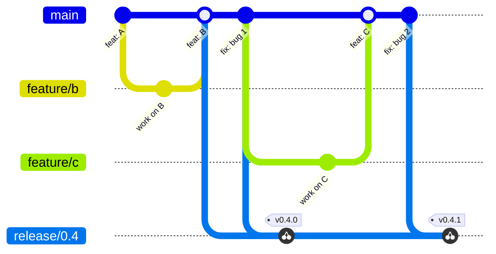

# Branches, pull requests and releases

How a change reaches `main`, how a release is cut from it, and how a fix
reaches a release that is already out. [CONTRIBUTING.md](../../CONTRIBUTING.md)
has the short version.

## The branches

| Branch or ref | Purpose | Lifetime |
| --- | --- | --- |
| `main` | The integration branch. It always passes CI, but it is not a release. | Permanent |
| `feature/*`, `fix/*` | One change each, branched from `main` and merged back through a pull request. | Hours to days |
| `release/X.Y` | Stabilization and patches for one minor version. Fixes only. | As long as the version is supported |
| `vX.Y.Z` (tag) | A release: what users install. | Permanent, never moved |



`main` moves quickly. Releases are deliberate: only a tagged version is
stable.

## Making a change

1. Branch from `main`: `git switch -c feature/short-description main`, or
   `fix/…` for a fix.
2. Keep the change small and about one thing.
3. Sign off every commit (`git commit -s`), certifying the
   [Developer Certificate of Origin](https://developercertificate.org/). A
   check on the pull request asks for it; `git rebase --signoff main` adds a
   missing one to every commit of the branch.
4. Open a pull request against `main`. CI must pass before it is merged.
5. Give the pull request a title that is a
   [Conventional Commit](https://www.conventionalcommits.org/), lowercase and
   short — `feat: add subgraph export`, `fix: handle an empty class`,
   `docs: …`, `refactor: …`, `test: …`, `chore: …`, `ci: …`. Squash merging
   is recommended: one pull request becomes one commit on `main`, and its
   **title becomes that commit's message**. A pull request merged another
   way keeps its commits, so their messages take the same form. These
   messages are what a release's notes are made from.

## Releases

Versions follow [Semantic Versioning](https://semver.org/):
`MAJOR.MINOR.PATCH`. While the major version is `0`, a minor release may
contain breaking changes; a patch release never does. The
[Plugin Interface](../architecture/plugins.md#the-plugin-interface) is
experimental, and any release may change it.

### Cutting a release

When `main` has what a version is meant to bring, create its release branch:

```bash
git switch -c release/0.4 main
git push -u origin release/0.4
```

From then on, `release/0.4` only receives fixes. New features continue on
`main` and ship in the next version.

### Fixing a bug in a release

Fix it on `main` first, through an ordinary pull request, then bring that
commit to the release branch:

```bash
git switch release/0.4
git cherry-pick -x <sha-of-the-fix-on-main>
git push
```

`-x` records the original commit in the message. Fixing on `main` first means
the bug cannot come back in the next version.

### Publishing a release

```bash
git switch release/0.4
git tag -a v0.4.0 -m "Release 0.4.0"
git push origin v0.4.0
```

A patch release works the same way: cherry-pick the fixes, then tag
`v0.4.1`. Each release gets a GitHub Release whose notes list the commit
titles since the previous tag.

### Rules

- Tags are annotated (`-a`) and never moved or deleted. A broken release is
  followed by a new patch release.
- Release branches never receive features and are never merged back into
  `main`.
- A release that needs no stabilization can be tagged on `main` directly. Its
  release branch is then created from the tag, only if a patch is needed
  later: `git switch -c release/0.4 v0.4.0`.

## Migrations in releases

A migration is immutable once it has run anywhere
([decision 0001](../adr/0001-migrations-are-immutable-and-forward-only.md)),
and the runner checks each one's checksum. So:

- **A fix that needs a migration** lands on `main` first, like every fix, and
  is cherry-picked unchanged: the release branch gets the identical file, and
  a database that ran it on either line runs nothing new on the other.
- **The migrations are squashed into a baseline only when a minor or major
  version is cut from `main`**, never in a patch
  ([decision 0016](../adr/0016-migrations-squash-into-a-baseline-at-a-milestone.md)).
  The last release before the squash is the one an older installation
  upgrades through, and the baseline's header names it
  ([Across the baseline](upgrading.md#across-the-baseline)).

## AI-assisted contributions

Changes written with coding agents are welcome, and follow the same rules as
any other:

- One task per branch and pull request, so that each stays reviewable, and
  the pull request is squash-merged.
- The person who opens the pull request has read the change, understands it,
  and is accountable for it.
- Agents do not push to `main` or to `release/*`, and do not create tags.
